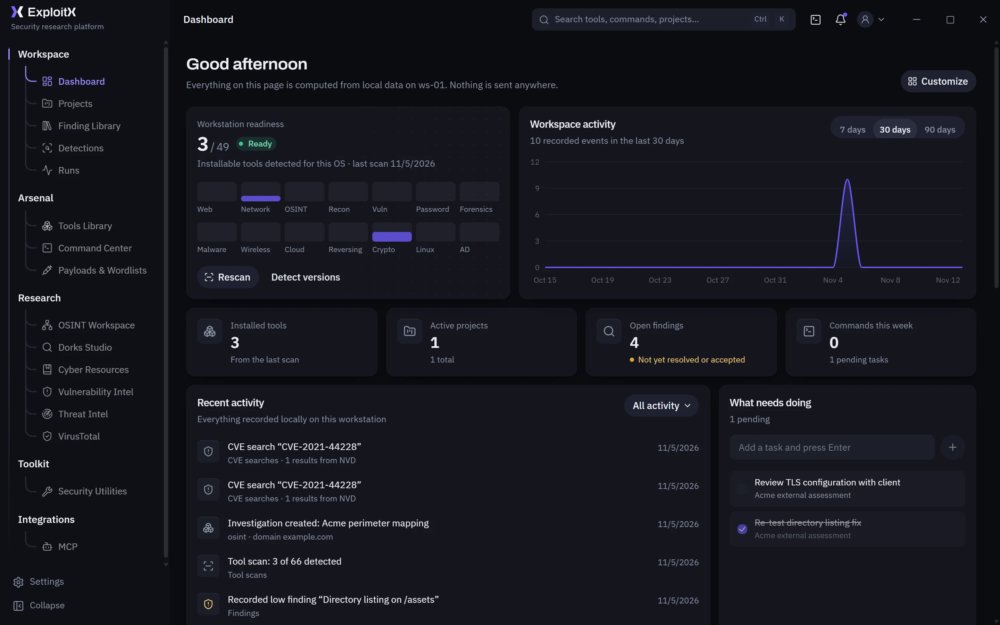
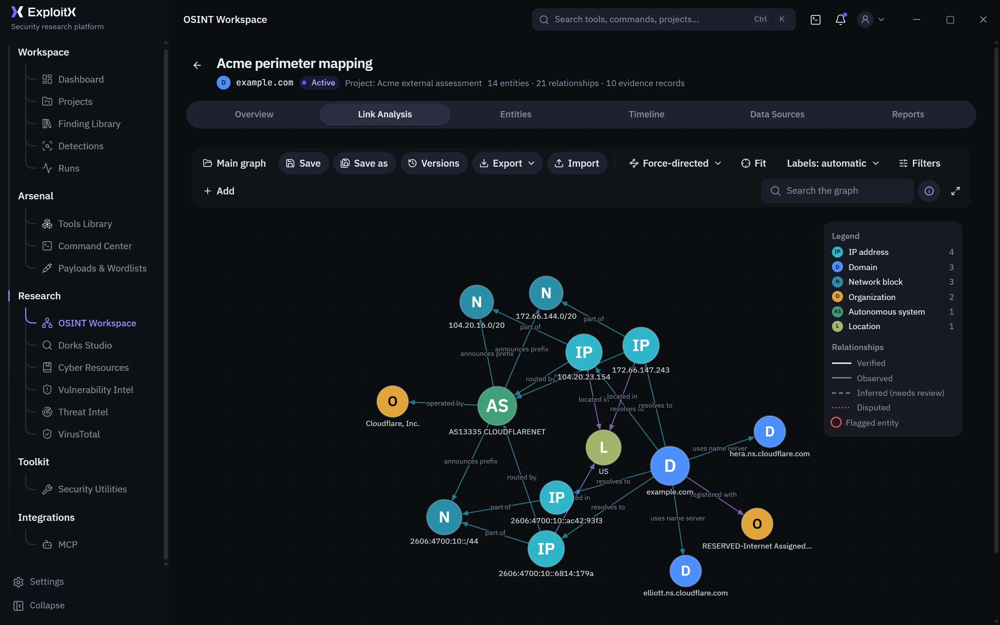
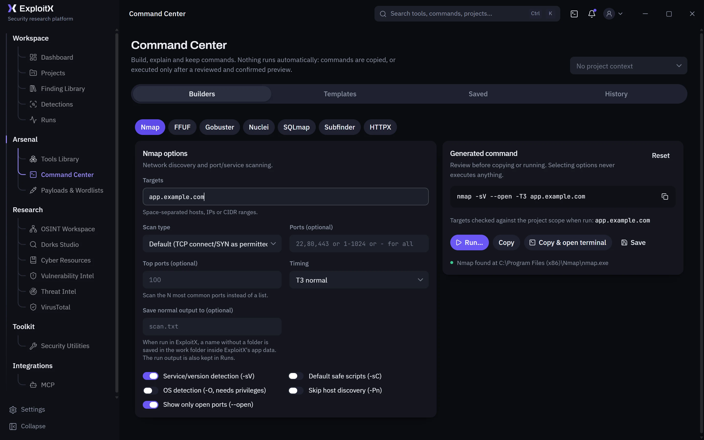

<p>
  <picture>
    <source media="(prefers-color-scheme: dark)" srcset="design/brand/logo-horizontal.svg">
    
  </picture>
</p>

# ExploitX

**Cybersecurity intelligence & security research platform.** Website: [exploitx.net](https://exploitx.net) (in preparation) · formerly *Cyber Hub* ([what changed](docs/brand/NAME_MIGRATION.md)).

**ExploitX is a cross-platform cybersecurity desktop workspace for security research, assessment, investigation and workflow management.** It is local-first: one app on your own Windows or Linux computer, with no account and no telemetry, built with **Tauri 2 (Rust)** and **React 19 + TypeScript**.

It is for **penetration testers, security analysts, threat-intelligence and OSINT researchers, and AppSec engineers** who want their tools, targets, findings and evidence in one place, with a scoped execution engine that asks before it runs anything.



| | |
|---|---|
|  |  |

*Screenshots of the app with demo data.*

## Status

* **Pre-release, under active development** for **Windows 10/11 x64** and **Linux x64**. macOS is not supported.
* **No public release and no downloads yet.** Release candidates of 0.1.0 exist only as private drafts for testing. Build from source to try ExploitX.
* **Not code-signed yet.** The Windows installers built so far are not Authenticode-signed, so Windows SmartScreen warns about them.
* **Publicly developed; the project license is pending the owner's selection** (see [License](#license)). ExploitX is not yet open-source licensed.

## Main capabilities

* **Projects:** scope (domains, CIDRs, URL paths, exclusions), findings with CVSS 4.0/3.1, evidence, scan imports (Nmap, Nuclei, Nessus, OpenVAS, Burp, ZAP, SARIF, Prowler, CSV), OWASP WSTG and ASVS 5.0 assessments, API security, SBOM and dependency analysis, ATT&CK mapping, reports.
* **A scoped execution engine:** a catalog of 70 tools with real installation detection, command builders, and runs that need a native OS confirmation and stay inside the project's authorized scope.
* **Threat intelligence and vulnerability intelligence:** VirusTotal, AbuseIPDB, AlienVault OTX, abuse.ch, Shodan, TAXII 2.1 feeds, NVD CVE search, STIX 2.1 export.
* **OSINT workspace:** investigations with a link-analysis graph, public-source collection with review before import, versions and exports.
* **Detection engineering:** Sigma and YARA rules with tests, explanations and ATT&CK coverage.
* **Security utilities:** offline analysers for files, logs, packet captures, containers, cloud and IaC, plus encoders, a JWT inspector, an HTTP request builder and a TLS analyzer.
* **MCP:** Claude Code, Claude Desktop and other MCP clients can use ExploitX's functions, with approvals inside the app.

The full list is below, under [Modules](#modules).

## Installation

There are **no public packages yet**. When releases are published, they will appear on the repository's [Releases](https://github.com/RChefo/ExploitX/releases) page with SHA-256 checksums and update signatures.

Until then, build and run ExploitX from source.

## Building from source

Prerequisites:
* **Node.js** 20.19+ or 22.12+ (required by Vite 8);
* **Rust** 1.90+;
* the [Tauri 2 system prerequisites](https://v2.tauri.app/start/prerequisites/) for your OS: WebView2 on Windows; on Linux `libwebkit2gtk-4.1-dev libgtk-3-dev librsvg2-dev libdbus-1-dev`.

Details: [CONTRIBUTING.md](CONTRIBUTING.md).

```bash
git clone https://github.com/RChefo/ExploitX.git
cd cyber-hub
npm ci                 # also runs scripts/patch-deps.mjs (freezePrototype compatibility, self-tested)
npm run tauri dev      # run the desktop app with hot reload
```

* **Your data.** A build from source uses the same data folder as an installed ExploitX. To keep a development build away from your own data, set `CYBERHUB_DATA_DIR` to an empty folder: debug builds honour it.
* **A local installer:** `npx tauri build --config '{"bundle":{"createUpdaterArtifacts":false}}'`. It needs no signing key, and it is unsigned: for your own testing only.
* `npm run dev` alone starts a browser preview of the interface, without the backend.

## Testing

```bash
npx tsc --noEmit -p tsconfig.json                      # TypeScript
npx vitest run                                         # frontend and script tests
cd src-tauri && cargo test --locked                    # backend, including upgrades from every database schema
cargo clippy --locked --all-targets -- -D warnings     # lints (from src-tauri/)
```

CI runs these on Windows, Ubuntu 24.04 and Debian 12, plus dependency audits, secret scanning and license and link checks. The automated tests need no network service and no API key. See [CONTRIBUTING.md](CONTRIBUTING.md#checks).

## Modules

| Module | Highlights |
|---|---|
| Dashboard | Workstation readiness (tool coverage by category), activity chart, key numbers, activity feed, tasks, favorite and recent tools, recent commands and projects, resource shortcuts, system info. Customizable (show/hide, reorder). |
| Tools Library | 70 tools in 14 categories with docs, platform support, dependencies, install steps per OS, common commands. Real detection (PATH plus known install paths), optional version probing, managed installs through winget, brew, pipx or go (exact command shown and confirmed first), GUI launch, scoped Run. |
| Command Center | Builders for Nmap, FFUF, Gobuster, Nuclei, SQLmap, Subfinder and HTTPX (structured argv, validation, run, copy, save), 49 OS-aware templates with explanations, saved commands with `{{placeholders}}`, and history. |
| Runs | Execution and installation history, live output, cancellation, stored output (up to 2 MB per run). |
| Payloads & Wordlists | 64 reference detection payloads plus your own, with encode-on-copy. A wordlist index that references files in place or copies them into a managed folder, with preview, search, export and favorites. |
| Dorks Studio | Visual operator builder, raw mode, live preview, 37 templates, saved queries, history, open in Google. |
| Cyber Resources | 46 curated sites, custom links, favorites, recently visited. |
| Threat Intel | One search across VirusTotal, AbuseIPDB, AlienVault OTX, URLhaus, MalwareBazaar, ThreatFox and Shodan (each optional; credentials are provisioned by the application owner). Per-provider verdicts in the provider's own terms, scores, malware families, categories, timestamps and source links. A side-by-side comparison, related indicators merged across providers with one-click pivots, saved indicators with their source and its reliability, confidence, validity and status (expired, revoked and false-positive indicators are kept but not presented as current), search history, Markdown/JSON reports, STIX 2.1 export of saved indicators with their lifecycle, and TAXII 2.1 feeds (collections discovered and synchronized incrementally on request, each connection confirmed; the analyst's records always win; a feed never creates a finding). See [docs/PROVIDERS.md](docs/PROVIDERS.md). |
| VirusTotal | Reputation lookups with automatic type detection, and File analysis: pick a file, hash it locally, check the hash, and only if you choose, upload it publicly after a warning and a system confirmation. Supports ≤ 32 MB and larger files via a one-time upload URL, with progress, cancellation and analysis tracking. |
| Vulnerability Intel | NVD CVE API 2.0 search (live or local cache, clearly labeled), CVSS 4.0/3.x/2.0 with vector breakdown, CWE names, affected products, references, CISA KEV flag, add as finding. |
| OSINT Workspace | Investigations with an interactive link-analysis graph (force, hierarchical, radial, circular and manual layouts, filters, groups, path finding, expansion, full screen), saved graphs with Save As, a Graph Manager and version history with compare and non-destructive restore. Collection from ExploitX data and public sources (DNS, Team Cymru ASN, RDAP, Certificate Transparency, GitHub, scoped web fingerprint, threat intelligence, NVD) with review before import. Evidence for every entity and relationship, qualitative confidence with reasons, review decisions, a timeline, deterministic suggestions, Markdown reports, and JSON/GraphML/CSV/PNG/SVG export with validated import. See [docs/OSINT.md](docs/OSINT.md). |
| Projects | Assessments with authorized scope (domains, wildcards, IPs, CIDRs, exclusions, and URL entries that authorize only their paths, never the host), findings with evidence references, notes, tool run history, Markdown report export. Findings export as CSV, JSON, SARIF 2.1.0 (for GitHub code scanning and vulnerability managers) or an ATT&CK Navigator layer of the techniques they name. Import of Nmap, Nuclei, Nessus, Greenbone/OpenVAS, Burp Suite, OWASP ZAP, SARIF and Prowler (OCSF) results, and of any CSV file with a column mapping, with a preview, scope checks, deduplication across imports and fix verification by rescan (for Prowler, from the checks that now pass) (see [docs/DATA_MODEL.md](docs/DATA_MODEL.md#scan-import-schema-13)). CVSS 4.0 and 3.1 vectors on findings with a calculator and scores computed as in FIRST's calculators. An OWASP WSTG testing checklist per project with coverage and findings linked to failed tests. OWASP ASVS 5.0.0 assessments at level 1, 2 or 3, with statuses only the analyst sets, notes, linked findings and evidence, the analyst's mappings, history and a Markdown report (see [docs/DATA_MODEL.md](docs/DATA_MODEL.md#asvs-assessments-schema-25)). An API inventory from OpenAPI, Swagger, Postman and HAR files with checks mapped to the OWASP API Security Top 10 (2023), a test plan, scope status per endpoint and a link to the request builder. SBOM and dependency lockfile analysis (CycloneDX, SPDX; npm, Yarn, pnpm, Cargo, Poetry, uv, Pipfile, requirements.txt, Composer, Bundler, go.mod, NuGet, Gradle) with license risks, completeness and supply-chain checks, and known vulnerabilities from the SBOM or OSV.dev; two versions can be compared for added, removed, upgraded and downgraded components, new vulnerabilities, packages from another source and changed package contents. An Investigation tab that correlates the modules' results into reviewed relationships (each with its reason, matched fields, origin and confidence; nothing is confirmed without you), a panel of everything related to a record, an investigation graph with paths and JSON/SVG/PNG export, remediation groups of findings that one fix addresses, investigation playbooks as workflow templates (suspicious file, incident logs, vulnerable dependency, web application, cloud account), an ATT&CK matrix that keeps techniques named by findings, your assessments and imported Navigator layers (such as detection coverage) apart, with gaps and layer export, a filtered and exportable timeline, and evidence provenance (see [docs/DATA_MODEL.md](docs/DATA_MODEL.md#investigation-layer-schema-22)). |
| Detections | A library of Sigma rules (specification v2.1.0, correlation rules included) and YARA rule files (boreal, compatible with YARA 4.5): import and validation that reports unsupported features instead of ignoring them, versions and comparison, collections, export, tests on log and file samples with expectations and regression re-tests, explanations of every match (fields for Sigma, strings and offsets for YARA), feedback and false positives. Projects run the rules on their evidence (Sigma on logs, YARA on any file), and File Triage scans the file it analysed; matches stay hits until promoted to findings. ATT&CK coverage of the rules with gaps and a Navigator layer export. See [docs/DATA_MODEL.md](docs/DATA_MODEL.md#detection-engineering-schema-24). |
| Finding Library | Reusable finding write-ups: start a finding from a template, save a finding as one, 14 starter templates, JSON export and import, and import rules so scan imports use your text for matching scanner rules (see [docs/DATA_MODEL.md](docs/DATA_MODEL.md#finding-library-schema-14)). |
| Security Utilities | Transform workbench (with defang and refang), Base64, URL, Hex, JWT inspector, hash identifier, hash calculator, IOC extractor, regex tester, JSON/XML/HTML formatters, URL parser, IP/CIDR calculator, User-Agent parser, DNS lookup, HTTP header analyzer, Container & Kubernetes checks (Dockerfiles, Compose files and manifests against the Pod Security Standards and the CIS Docker Benchmark; RBAC roles and bindings for ways to more privileges), Cloud & IaC checks (Terraform, CloudFormation and AWS IAM policies, including account exports, for public resources, open security groups and privilege escalation), File triage of PE and ELF programs without running them (hashes and import hash, sections and entropy, hardening, ATT&CK-mapped capabilities from imports, strings and indicators), Linux persistence triage of an image or triage collection (cron, systemd, preloaded libraries, shell start-up files, SSH keys, accounts, sudo and PAM, with ATT&CK techniques), packet capture triage (pcap, pcapng, with hunting leads for beacon-like timing and DNS tunneling or generated domains) and log triage (web access and SSH logs, and Windows event logs with ATT&CK-mapped detections), and the scope-checked HTTP request builder (form or raw requests, session history, resend, response comparison, cURL), TLS analyzer and OAuth & OpenID Connect review (an authorization server's metadata, pasted or fetched within scope, checked against RFC 9700 and the OpenID Connect specifications). |
| MCP integration | Claude Code, Claude Desktop and other MCP clients can use ExploitX's real functionality through `cyberhub-mcp`: 62 tools, 7 resources and 6 prompts, including record search, related records, relationships, the ATT&CK matrix, detection rules and hits, and ASVS assessments; correlation and relationship proposals from a client stay suggestions until you accept them. Sensitive operations (runs, uploads, exports, local writes and, by default, external lookups) wait for your approval inside ExploitX, and every call is recorded. The MCP page in the sidebar has the status, Approval Center, clients, tool catalog, permissions, audit log and client setup. See [docs/MCP.md](docs/MCP.md). |
| Global search | `Ctrl/⌘ + K` across tools, commands, resources, projects, dorks, payloads, wordlists, utilities and pages, and the records of open projects (findings, assets, vulnerabilities, evidence, OSINT entities, tool runs, API endpoints, SBOM components), each opening in its project. |

## Security at a glance

* Every tool run and installation needs a **native OS confirmation** that page script cannot click.
* Scope-required tools run only inside an active project; every target on the command line **and inside target files** (e.g. `nmap -iL`) is validated, and target files are executed from validated snapshots.
* No shell, closed stdin, absolute executable paths, whole process trees cancelled, credentials redacted before storage.
* Minimal Tauri capabilities (no shell/fs/dialog/HTTP for the web view), strict CSP, `freezePrototype` on.
* MCP clients reach ExploitX only through an authenticated loopback bridge that is off by default. They use the same scope engine and native confirmations as the GUI and cannot approve their own sensitive requests.
* Service credentials are provisioned by the application owner with a developer-only tool ([docs/PROVISIONING.md](docs/PROVISIONING.md)), stored in the OS credential store and read only by the Rust backend. No UI or IPC command can read or change them, and none are shipped in binaries or installers.
* Files are uploaded to VirusTotal only after a public-sharing warning, an in-page acknowledgement and a native confirmation for that file. The original file is never modified.
* Updates come only from the official Tauri updater: each package must carry a signature from the ExploitX update key that names its version, feeds and downloads must use HTTPS, and nothing is installed without a native confirmation or while work is running ([docs/UPDATER.md](docs/UPDATER.md)).

Details and accepted risks: [docs/SECURITY.md](docs/SECURITY.md).

## Documentation

[docs/README.md](docs/README.md) lists every document, grouped for users, for contributors and for internal release engineering. The website (exploitx.net) has its own repository, [RChefo/ExploitX-Web](https://github.com/RChefo/ExploitX-Web). Most used:

* [docs/SECURITY.md](docs/SECURITY.md): the security model;
* [docs/PLATFORMS.md](docs/PLATFORMS.md): platforms, dependencies and validation status;
* [docs/ARCHITECTURE.md](docs/ARCHITECTURE.md) and [docs/governance/DEVELOPMENT_GUIDE.md](docs/governance/DEVELOPMENT_GUIDE.md): how it is built;
* [docs/MCP.md](docs/MCP.md), [docs/OSINT.md](docs/OSINT.md), [docs/PROVIDERS.md](docs/PROVIDERS.md), [docs/UPGRADE.md](docs/UPGRADE.md), [docs/UPDATER.md](docs/UPDATER.md).

## Reporting security issues

Please **do not** open a public issue for a vulnerability. Report it privately through [GitHub's vulnerability reporting](https://github.com/RChefo/ExploitX/security/advisories/new). Details are in [SECURITY.md](SECURITY.md).

## Contributing

Bug reports, reproductions and documentation fixes are welcome; see [CONTRIBUTING.md](CONTRIBUTING.md), [SUPPORT.md](SUPPORT.md) and the [Code of Conduct](CODE_OF_CONDUCT.md). Larger code contributions may wait until a license is selected.

## License

**ExploitX is publicly developed. Its project license is pending the owner's selection.** A public repository is not open source by itself: until the owner selects a license and adds a LICENSE file, no rights to use, modify or redistribute the code are granted beyond what GitHub's Terms of Service allow for public repositories (viewing and forking on GitHub). The options are compared in [docs/governance/LICENSE_COMPARISON.md](docs/governance/LICENSE_COMPARISON.md); Apache-2.0 is recommended and awaits the owner's approval.

The groundwork is done (Mission 14): no third-party component with a non-open license remains, every dependency is checked against a [license policy](docs/governance/DEPENDENCY_LICENSE_POLICY.md) in CI, and every package ships the license texts of what it contains (`THIRD_PARTY_LICENSES.txt`, shown in Settings > About).

Third-party code, data, fonts and icons keep their own licenses: see [THIRD_PARTY_NOTICES.md](THIRD_PARTY_NOTICES.md), [docs/governance/THIRD_PARTY_LICENSE_AUDIT.md](docs/governance/THIRD_PARTY_LICENSE_AUDIT.md) and, for the Linux packages' system libraries, [docs/governance/DISTRIBUTION_LICENSE_COMPLIANCE.md](docs/governance/DISTRIBUTION_LICENSE_COMPLIANCE.md).
